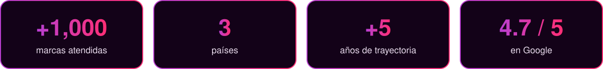

  

 

## Sobre 3R Core

Somos una agencia de marketing digital con sede en Lima, Perú. Combinamos tres generaciones de experiencia, visión estratégica y tecnología para diseñar estrategias a la medida de cada marca, con foco en **tiendas virtuales, posicionamiento SEO y Google Ads**. Atendemos a empresas en Perú y Estados Unidos.

 

  

 

## Servicios

| Servicio | Alcance |
| :-- | :-- |
| [**Tiendas virtuales**](https://3rcore.com/es/tiendas-virtuales-lima) | E-commerce en Shopify, WooCommerce o Tiendanube con pasarelas de pago locales (Culqi, Niubiz, Izipay, Yape, Mercado Pago), listas para vender. |
| [**Posicionamiento SEO**](https://3rcore.com/es/posicionamiento-seo) | SEO orgánico, técnico y local, estrategia de palabras clave y reportes mensuales. |
| [**Google Ads / SEM**](https://3rcore.com/es/servicios/google-ads) | Campañas de Búsqueda, Performance Max, YouTube, Display y Shopping con reportes en Looker Studio. |
| [**Desarrollo web**](https://3rcore.com/es/servicios/web-development) | Sitios corporativos, landing pages, e-commerce y plataformas e-learning. |
| [**Branding**](https://3rcore.com/es/servicios/branding) | Identidad visual, logotipos, manuales de marca y aplicaciones. |
| [**Social Media**](https://3rcore.com/es/servicios/socialmedia) | Estrategia de contenidos, diseño de piezas, grillas editoriales y gestión de redes. |
| [**Meta Ads**](https://3rcore.com/es/servicios/meta-ads) y [**TikTok Ads**](https://3rcore.com/es/servicios/tiktok-ads) | Publicidad en Facebook, Instagram y TikTok: segmentación, creatividades y retargeting. |
| [**Performance Marketing**](https://3rcore.com/es/servicios/performance-marketing) | Adquisición orientada a ROI y ROAS, embudos de venta y medición. |
| [**Email Marketing**](https://3rcore.com/es/servicios/email-marketing) | Campañas, automatizaciones, segmentación de listas y flujos de nurturing. |

**Soluciones por industria:** [Clínicas y consultorios](https://3rcore.com/es/servicios/marketing-clinicas) · [Inmobiliarias](https://3rcore.com/es/servicios/marketing-inmobiliarias) · [E-commerce](https://3rcore.com/es/servicios/marketing-ecommerce)

## Tecnología

## Mercados

| Mercado | Oferta | Sitio |
| :-- | :-- | :-- |
| **Perú** | Catálogo completo de servicios, con sede en La Molina, Lima. | [3rcore.com/es](https://3rcore.com/es) |
| **Estados Unidos** | Sitios web, SEO y tiendas online, atendidos de forma remota. | [English](https://3rcore.com/en) · [Español](https://3rcore.com/us) |

## Recursos

- [Blog](https://3rcore.com/es/blogs): guías de marketing, SEO, branding y desarrollo web.
- [¿Cuánto cuesta una página web en Perú?](https://3rcore.com/es/cuanto-cuesta-una-pagina-web-en-peru)
- [Preguntas frecuentes](https://3rcore.com/es/preguntas)
- [Nosotros](https://3rcore.com/es/nosotros): equipo, fundadores y metodología.

## Contacto

| | |
| :-- | :-- |
| **Dirección** | Alameda de la Paz 187, primer piso, Urb. El Remanso, La Molina, Lima 15024, Perú |
| **Teléfono / WhatsApp** | [+51 987 216 703](https://wa.me/51987216703) |
| **Email** | [info@3rcore.com](mailto:info@3rcore.com) |
| **Horario** | Lunes a viernes, 09:00 – 18:00 (PET / UTC-5) |

 

  

© 3R Core · Agencia de Marketing Digital · Lima, Perú

